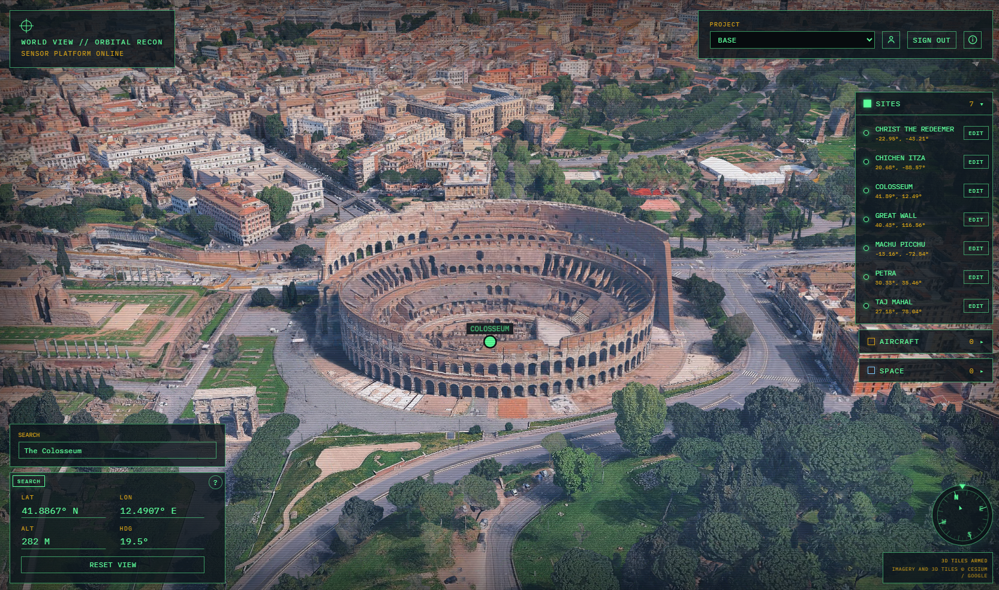
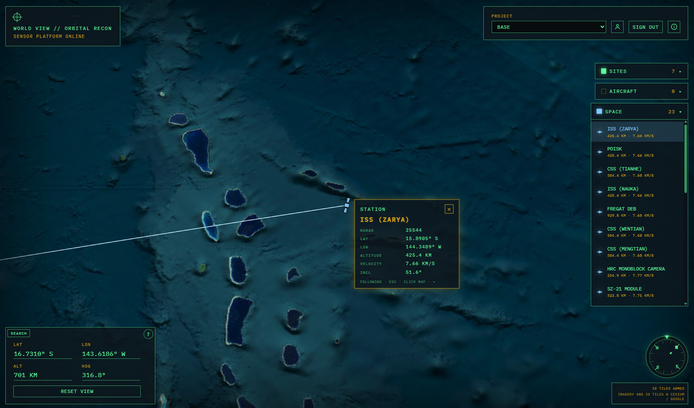

# World View



World View is the application. This repository, [Twinit-App-Template-Worldview](https://github.com/Invicara/Twinit-App-Template-Worldview), is the public template.

```bash
git clone https://github.com/Invicara/Twinit-App-Template-Worldview.git
```

Sign in and you get a fullscreen globe of Earth. Drop the camera below about 50 km, with a Cesium ion token set, and photorealistic 3D tiles come up.


|                                                           |                                                                                                       |
| --------------------------------------------------------- | ----------------------------------------------------------------------------------------------------- |
| **Developers** deploying the World View base and the web client | [Base developer guide](docs/base-template/developer%20guide/README.md) |
| **Operators** using the globe, sites, aircraft, and space | [Base user guide](docs/base-template/user%20guide/README.md) |
| **Feature extensions** (optional templates, including airports) | [Template Feature Extensions](docs/feature-extensions/README.md) |
| Release history | [Release Notes](docs/release-notes.md) |




## What you get

World View is a base template. Deploy it and you have a working application: a fullscreen globe, saved sites, aircraft, space, and personnel. Other templates layer on top of that same project when you want a specific workflow. The base stays useful on its own. Each added template brings one workflow only where you install it.

- A Vite + React client: a classified-style HUD on a Cesium globe
- The **World View** template. It creates the backend: the API, the Sites and Space Catalog collections, and the space-catalog workflow. Sites start empty. People save their own locations.

The [base developer guide](docs/base-template/developer%20guide/README.md) covers that globe. [Template Feature Extensions](docs/feature-extensions/README.md) documents each added package in its own guides.

## Feature extensions

**sample-airports** is a second template you can lay on top of that base, on the same project. You do not have to. Install it when you also want 30 US large-hub airports, a Gates collection, DTW McNamara gate operations, and the gate MCP tools. The client already knows how to run without that layer: gate operations simply stay off.

## Run the client

1. Copy `client/.env.example` to `client/.env.local`.
2. Set `VITE_TWINIT_API`, `VITE_TWINIT_APP_ID`, and `VITE_CESIUM_ION_TOKEN`. The Cesium ion token is required. [Gather access](docs/base-template/developer%20guide/deploy/d1-gather.md) has the steps to create one.
3. From `client/`:

```bash
npm install
npm run dev
```

The dev server is pinned to **[http://localhost:8088/](http://localhost:8088/)** so it matches the World View application's Passport redirect URI.

Full deploy order and the data model are in the [base developer guide](docs/base-template/developer%20guide/README.md). Extension notes are in [Template Feature Extensions](docs/feature-extensions/README.md).