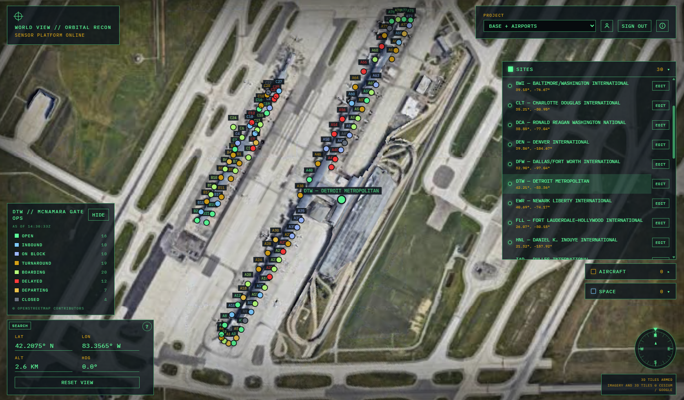

# Template Feature Extensions

A feature extension is a second template you deploy onto a project that already has the [World View base](../base-template/developer%20guide/README.md). The base stays a complete globe. The extension adds one slice: its own collection, rows in a collection the base already created, or a route patched onto the World View API. A project can only have one API config, so an extension does not ship a second one.

Each extension is documented on its own. It has a developer guide and a user guide in `docs/feature-extensions/<name>/`. Put each new extension in its own folder there.

[Add another feature extension](./adding-an-extension.md) is the checklist for the next package.

## Extensions

### sample-airports

30 US large-hub airports and DTW McNamara gate operations with MCP tools for Gate Status inquiries

* [Developer Guide](sample-airports/developer%20guide/README.md)
* [User Guide](sample-airports/user%20guide/README.md)

Operators of the base globe start at the [base user guide](../base-template/user%20guide/README.md). If a control from this catalog is missing, that extension was never installed.

---
[Docs](../README.md) < Back | Next > [Add another feature extension](./adding-an-extension.md)
