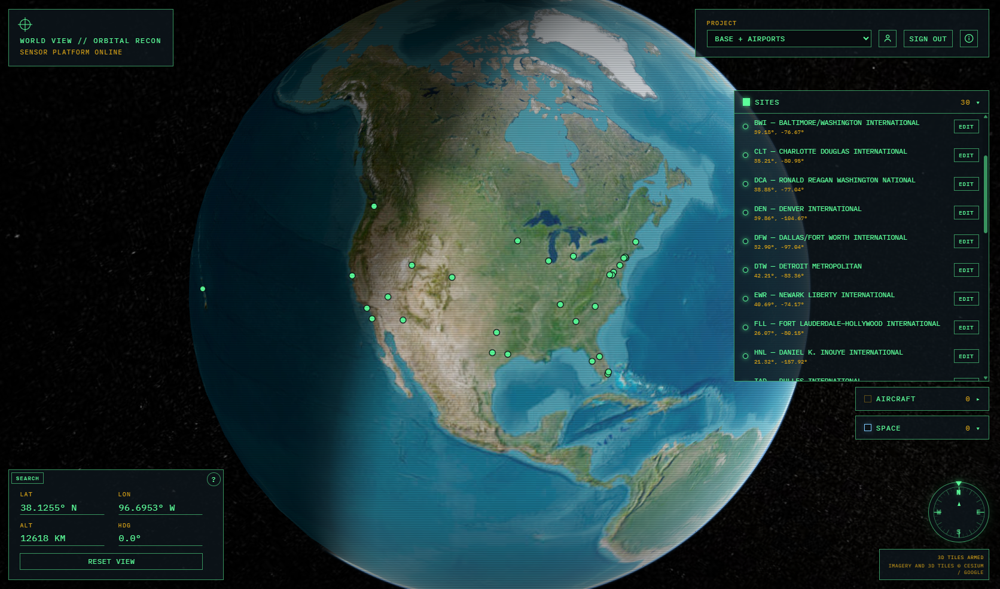

[User Guide](./README.md) < Back | Next > [Gate operations](./gate-operations.md)

---

# Airports

You only need this page if your project was given the airport layer. Look at SITES. If it is empty, that layer is not here. Save your own locations from the globe. See [Sites](../../../base-template/user%20guide/world-view/sites.md).

## The sample list

SITES includes 30 large US airports. Each name is the airport code, then the airport name, as in `DTW — Detroit Metropolitan`.

Select a row to fly there. These sites open at 3,000 m, looking straight down.

Deleting one removes it from this project only. Applying the sample package again puts a missing name back. It does not add a second copy of a name that is still in the list.

## Detroit

`DTW — Detroit Metropolitan` is the only site that unlocks [gate operations](./gate-operations.md). Other airports do not show that prompt.

---
[User Guide](./README.md) < Back | Next > [Gate operations](./gate-operations.md)
